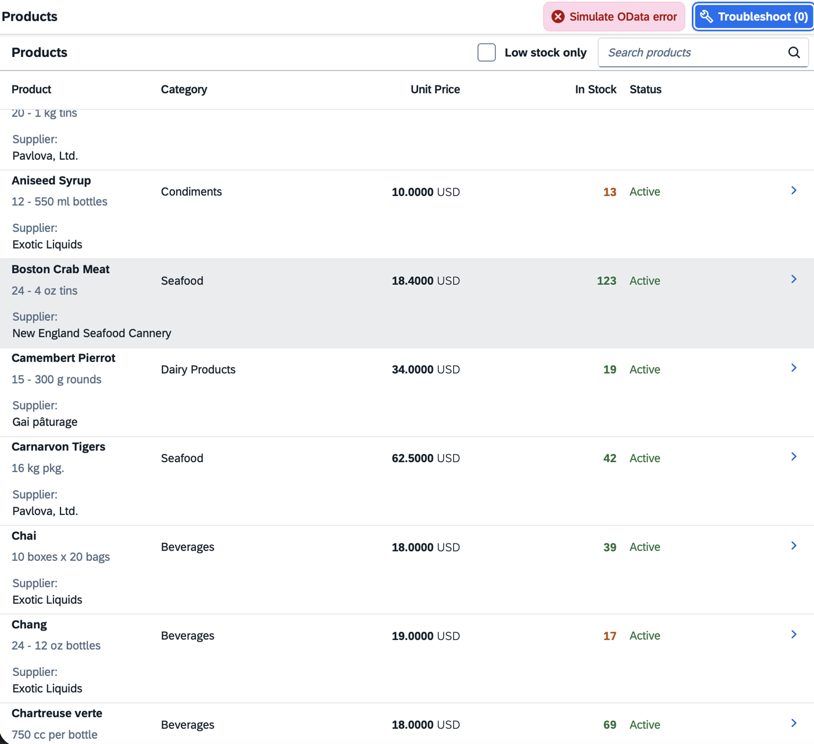
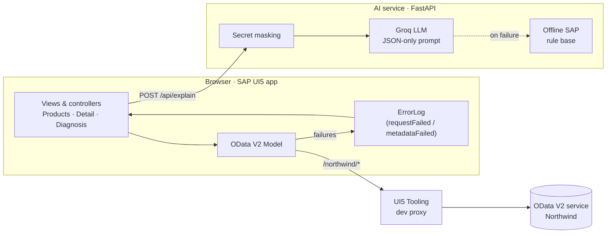
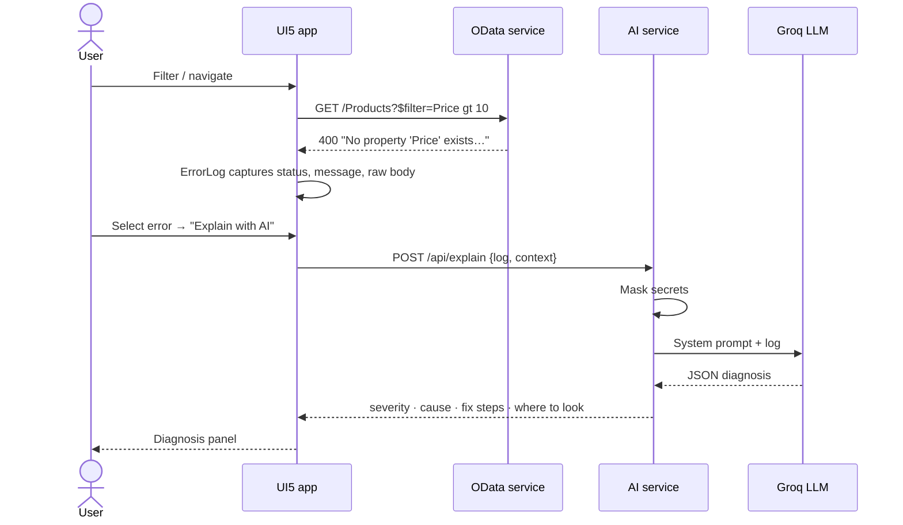

<div align="center">

# LogSense

### AI error diagnosis for enterprise web apps

**SAP UI5 front-end · OData back-end · LLM-powered root-cause analysis**

[](https://github.com/Abhinaya1901/logsense/actions/workflows/ci.yml)


</div>

---

When an enterprise app fails, the error usually arrives as an HTTP status, a terse back-end message, or a long ABAP short dump. Turning that into *"here is what broke, why, and where to look"* takes experience most developers don't have on day one.

**LogSense** captures failures as they happen inside a SAP UI5 application and uses an LLM to explain them: likely root cause, concrete fix steps, and the exact tools or transactions to check. It works offline too, thanks to a built-in rule base of common SAP errors.

<p align="center">
  
</p>

## Highlights

| | |
|---|---|
| **SAP UI5 application** | XML views, MVC controllers, manifest-driven routing and data binding, `sap_horizon` theme, responsive tables with pop-in columns and lazy loading. |
| **OData V2 consumption** | `ODataModel` declared in `manifest.json`, `$expand` of related entities (Category, Supplier), server-side filtering and inline counts. |
| **Automatic error capture** | Every failed OData request and metadata load is intercepted via `requestFailed` / `metadataFailed` and parsed from SAP Gateway error bodies into a central log. |
| **LLM diagnosis** | Errors, stack traces or pasted logs are sent to an LLM (Groq) with a strict JSON contract and returned as severity, root cause, fix steps and where to look. |
| **Privacy by default** | Authorization headers, passwords, API keys and CSRF tokens are masked *before* any log leaves the app. |
| **Graceful degradation** | No API key or model outage? An offline rule base covers common OData, Gateway and ABAP runtime errors, so the tool never returns nothing. |
| **Engineering hygiene** | pytest suite, UI5 linter clean (manifest v2, UI5 2.x ready), GitHub Actions CI on every push. |

## How it works



### What happens when something breaks



### Example diagnosis

Request:

```json
{ "log": "HTTP 404 Not Found\nMessage: Resource not found for the segment 'ProductCatalog'.", "context": "odata" }
```

Response:

```json
{
  "severity": "Medium",
  "summary": "The OData service could not find the requested entity set or key.",
  "likely_cause": "The entity set name is wrong, the key value does not exist, or the service is not registered / activated on the Gateway.",
  "fix_steps": [
    "Check the entity set name against $metadata (names are case-sensitive).",
    "Verify the key value exists, e.g. read the entity set without a key first.",
    "Confirm the service is registered and active in /IWFND/MAINT_SERVICE."
  ],
  "where_to_look": "/IWFND/MAINT_SERVICE, /IWFND/ERROR_LOG, browser Network tab.",
  "source": "offline SAP rule base"
}
```

## Tech stack

| Layer | Technology |
|---|---|
| Front-end | SAP UI5 (`sap.m`, `sap.ui.layout`), XML views, JSON & OData V2 models, UI5 router |
| Tooling | UI5 Tooling (`@ui5/cli`), `ui5-middleware-simpleproxy`, UI5 linter |
| Data | OData V2 (public Northwind service) |
| AI service | Python, FastAPI, Pydantic, httpx, Groq (OpenAI-compatible API) |
| Quality | pytest, GitHub Actions |

## Getting started

**Prerequisites:** Node.js 20+, Python 3.10+

**1. Start the AI service**

```bash
cd ai-service
python3 -m venv .venv
source .venv/bin/activate          # Windows: .venv\Scripts\activate
pip install -r requirements.txt
cp .env.example .env               # optional: add GROQ_API_KEY from console.groq.com
uvicorn main:app --port 8000 --reload
```

Without a key, LogSense runs on the offline rule base. Health check: `http://localhost:8000/health`.

**2. Start the UI5 app** (in a second terminal)

```bash
cd app
npm install
npm start                          # opens http://localhost:8080/index.html
```

**3. Try it**

1. Browse and search products; open one to see the detail page loaded with `$expand`.
2. Click **Simulate OData error** a few times. Each click fires a realistic failing request (invalid `$filter` property → 400, unknown entity set → 404, unknown key → 404).
3. Open **Troubleshoot**, select a captured error, and click **Explain with AI**.
4. Paste any log instead, e.g. an ABAP dump:
   ```
   Runtime Errors   COMPUTE_INT_ZERODIVIDE
   Exception        CX_SY_ZERODIVIDE
   ```

## Errors recognised offline

| Category | Examples |
|---|---|
| OData / Gateway | Unknown property in `$filter`/`$select`, unknown entity set or key, CSRF token failure, HTTP 500 from the service implementation |
| Security | HTTP 401 / 403, missing authorizations |
| ABAP runtime | `CX_SY_ZERODIVIDE`, `CX_SY_ITAB_LINE_NOT_FOUND`, `CX_SY_REF_IS_INITIAL`, `CX_SY_CONVERSION_NO_NUMBER`, `TIME_OUT` |
| Front-end | CORS / cross-origin blocks |

## Design decisions

- **Errors are captured at the model, not per call.** Listening to the OData model's events means every request in the app is covered automatically, including ones added later, without extra code in each controller.
- **The LLM must answer in JSON.** A fixed schema (`severity`, `summary`, `likely_cause`, `fix_steps`, `where_to_look`) keeps the UI simple and makes responses testable.
- **Mask first, then send.** Logs often contain credentials and session tokens; they are redacted server-side before reaching any third-party model.
- **Never fail empty.** If the LLM is unavailable, the rule base answers and the response says which engine produced it, so the user always knows how much to trust it.
- **Proxy in development.** The UI5 Tooling proxy avoids browser CORS issues, the same role a BTP destination or SAP Gateway plays in production.

## Project structure

```
logsense/
├── app/                              SAP UI5 application
│   ├── ui5.yaml                      UI5 Tooling config + OData proxy
│   └── webapp/
│       ├── manifest.json             App descriptor: data source, models, routing
│       ├── Component.js              Wires models, error log and router
│       ├── util/ErrorLog.js          Captures and parses failed OData requests
│       ├── model/formatter.js        Value-state formatters
│       ├── view/                     Products, ProductDetail, Troubleshoot (XML)
│       └── controller/               Matching controllers
├── ai-service/                       Diagnosis API
│   ├── main.py                       FastAPI endpoint, Groq call, secret masking
│   ├── rules.py                      Offline SAP error rule base
│   └── tests/                        pytest suite
└── .github/workflows/ci.yml          Tests, lint and build on every push
```

## Testing

```bash
cd ai-service && pytest -q            # API contract, rules, masking, LLM fallback
cd app && npm run lint && npm run build
```

## Roadmap

- [ ] Replace the public service with my own OData service written in ABAP (RAP) on the SAP BTP ABAP environment
- [ ] Deploy the UI to SAP BTP with a destination instead of the dev proxy
- [ ] Group recurring errors and show trends over time
- [ ] Suggest code-level fixes from the ST22 source extract

## Author

**Kolla Srinivasan Abhinaya** · [LinkedIn](https://www.linkedin.com/in/abhinaya-srinivasan-0921552bb) · [GitHub](https://github.com/Abhinaya1901)

Released under the [MIT License](LICENSE).
